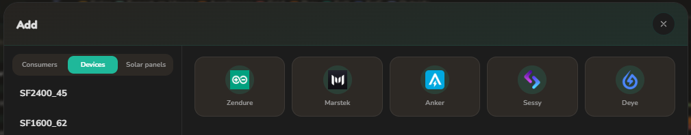

# ZenMaster

ZenMaster is a Home Assistant integration that plans and steers a home battery fleet, heat pumps and other large loads against the dynamic energy price, the solar forecast and the house's own load. Every quarter of an hour it solves a linear optimisation (LP, with the HiGHS solver) over the next 48 hours and sends each device its setpoint.

[![hacs][hacsbadge]][hacs] [![releasebadge]][release] [![License][license-shield]](LICENSE) [![hainstall][hainstallbadge]][hainstall]


## The panel

ZenMaster adds its own panel to the Home Assistant sidebar, with five tabs: **Planning**, **Devices**, **Solar**, **History** and **Settings**.

### Header

| Tile | Shows |
|---|---|
| **P1** | Grid import or export now, per phase (L1, L2, L3) |
| **Power** | What the batteries deliver (+) or take (-) now |
| **Solar** | Solar production now |
| **Savings** | What the plan saved today |
| **Consumers** | What the managed consumers draw now |

The round button top right switches the optimisation on or off. On, the battery mode follows the plan every quarter; off, the fleet goes back to its own behaviour.

### Planning chart

The chart shows the plan for the coming 48 hours per quarter:

- **Solar**, **Export**, **House load**, **Consumers** and **Grid import** as bars, in kW.
- **Buy price** and **Sell price** as lines, in EUR/kWh, with the current price marked. Where the day-ahead prices end, the line continues dashed on the price model.
- **SoC** of the fleet as a dotted line, between its min and max.
- **Outside temperature** as a line, on the axis on the left in °C.

With the arrows above the controls you step back through earlier days. The chart and the lanes then show what really happened that day, per quarter, from the Home Assistant recorder: solar, export, house load, consumers, grid import, the prices, the SoC of the fleet and every battery and consumer on its own, with the outside temperature from Open-Meteo. **Today** brings back the live plan. The recorder keeps 5-minute values for about ten days; older days show hourly values.

### Controls

- **Mode**: off, manual, smart, smart charging, smart discharging, store solar, or individual, where every battery gets its own setpoint from the plan.
- **Manual**: the fleet setpoint in manual mode, in W.
- **Max grid**: the connection limit in kW. The plan keeps every phase under its third of it.
- **Correction**: a fixed offset on the setpoint, in W.

### Device and consumer lanes

Under the chart each battery and each consumer has its own lane with its plan per quarter, or on an earlier day what it really did. Hover a bar to see its time and power. Each row shows its phase, its power now and, for a battery, its state of charge. **Add** opens the Add dialog (see below); **All devices** toggles between all and only the online devices; **Pair** connects a new Zendure battery over Bluetooth.

### Adding devices

**Add** under the lanes opens the Add dialog, with a tab for consumers, devices and solar panels. On the left are the ones you already have; pick one to edit or remove it. On the right are the tiles of what you can add: pick a tile, fill in the form and press **Add**. Zendure devices are also found automatically, Anker devices over mDNS; the other brands are added by hand.



## What ZenMaster plans

### Batteries

#### Zendure

- SolarFlow 800, 1600, 2400 and 4000, Hyper 2000, Hub 1200 and 2000, AIO 2400 and Ace 1500, plus the Zendure P1 and CT smart meters.
- Steered over the local zenSDK HTTP API where the device has it, otherwise over a local MQTT broker, with Bluetooth as fallback. Devices are found automatically (MQTT, mDNS, Bluetooth).
- Every battery is planned on its own: its capacity, its power limits, its own solar input, its round-trip loss and its wear. A pack that has worked more than the fleet average costs a little more per kWh, so the plan spreads the work.
- The plan charges when power is cheap or solar is left over and discharges when it is expensive, within the phase limits of the connection.
- The phase of each battery and consumer is detected from its power jumps in the recorder history.

#### Experimental brands

Every brand other than Zendure is experimental: written against the vendor's register maps and documentation and tested against simulated devices, but not yet proven on real hardware. Feedback from owners is welcome.

- **Marstek** Venus E, A and D over Modbus TCP, directly or through an RS485 gateway. Added by hand with its register generation (v2, v3, A or D), its IP address and port. Steered with RS485 control mode and a charge or discharge setpoint; handed back to the work mode it had before. Control is opt-in per device (Allow control) and off by default; without it the device only reports.
- **Anker SOLIX** Solarbank Max AC, XE AC and Solarbank 4 E5000 Pro over Modbus TCP. Found over mDNS or added by hand with its IP address. Steered in Third-Party Control with one signed setpoint; handed back to the operating mode it had before.
- **Sessy** 5 kWh and 10 kWh over the dongle's local HTTP API. Added by hand with its IP address and the username and password on its sticker. Steered with the API power strategy and a setpoint; handed back to the strategy it had before.
- **Deye** three-phase hybrid inverters with an LV or HV battery, through their Solarman logger stick. Added by hand with the battery type, the logger's serial number, the battery capacity and the logger's IP address. Its grid meter appears as a device of its own that can be picked as the P1 meter. Steered per mode through its own settings (time-of-use programs, charge and discharge current, work mode, grid charging); its own settings are put back when ZenMaster hands it back. Control is opt-in per device (Allow control) and off by default; without it the device only reports.

### Heat pump for space heating

- The house is a two-store model (air and building mass) with heat loss, extra loss from wind, solar gain and internal gains. ZenMaster calibrates it every week from a year of recorder history: the daily heat balances on cloudy days give the loss, all cold days give the solar gain and the storage, and the night cooldowns give the share of the air.
- The COP follows from the indoor and outdoor temperature (Carnot with a fixed efficiency), less the energy the defrosts cost. Above a knee of 0.6 kW each extra kW gives less heat, so the plan prefers long, low runs.
- Comfort is a setpoint that must be reached in the evening, with a lower floor by day and at night. The plan only dips under the setpoint when that saves more than the comfort cost, so a night setback only happens when it pays.
- The plan keeps only runs the heat pump can make: no blocks under its minimum power (higher in the cold) and no runs shorter than half an hour.
- The setpoint goes to the heat pump as power, capacity, temperature or temperature difference, whichever its control entity takes.

### Other consumers

- **Hot water heat pump and electric boiler**: the tank is heated in the cheapest window that still keeps it above its minimum.
- **Pool heat pump**: kept in its temperature band at the lowest cost.
- **Dishwasher, washing machine, dryer and custom appliances**: once armed, the cycle is placed in the cheapest window before its deadline, within the phase limits.
- **EV charger**: off, solar (opportunistic while it pays), plan (reach a target SoC before departure) or fast.

#### Appliance switch types

An appliance is armed when it starts drawing power after a rest. The switch type sets how ZenMaster holds that cycle and lets it run:

- **Plug**: the smart plug is switched off at arming and on again in the cheapest window. The appliance has to resume after a power cut.
- **Pause/resume**: the appliance's own pause button is pressed at arming, its resume button in the cheapest window (for example Miele, or Home Connect washers and dryers).
- **Automation**: ZenMaster switches nothing and only publishes the status on `sensor.<appliance>_state`; your own automation holds the cycle on `armed` and lets it run on the change from `armed` to `planned` or `running` (the latter covers a direct start):

```yaml
triggers:
  - trigger: state
    entity_id: sensor.vaatwasser_state
    from: armed
    to: [planned, running]
actions:
  - action: button.press
    target:
      entity_id: button.vaatwasser_resume   # the appliance's own resume or start
```

An appliance that waits without drawing power, such as one set to remote start, is armed by pressing `button.<appliance>_arm`, for example from an automation on its remote start sensor.

### Prices, solar and base load

- **Dynamic prices** from Zonneplan, Tibber, Frank Energie, EnergyCharts or NextEnergy, or the wholesale price with the tariffs of a supplier in the Netherlands, Belgium, Germany, France or Austria (energy tax, grid fees, VAT and the feed-in rule per country). Net metering (saldering) is supported. Beyond the day-ahead prices a price model fitted on the price history fills in the rest of the 48 hours.
- **Solar forecast** from Open-Meteo, per solar group, calibrated against its own meter.
- **Base load** per phase from the last four weeks of the P1 meter, with the managed consumers taken out.

## Support

If you find this project helpful and want to support its development, consider buying me a coffee!
[![Buy Me a Coffee][buymecoffeebadge]][buymecoffee]

## Installation

### Through HACS (recommended)

1. Open HACS in Home Assistant and search for **ZenMaster**. Not listed yet? Add `https://github.com/FireSon/ZenMaster` under the three dots, **Custom repositories**, with the type **Integration**.
2. Install **ZenMaster** and restart Home Assistant.
3. Add the integration **ZenMaster** under Settings, Devices and services.
4. Open the ZenMaster panel in the sidebar, set the P1 meter and the dynamic price provider, and add your devices, consumers and solar panels with **Add**.

### By hand

1. Copy `custom_components/zenmaster` into the `custom_components` folder of your Home Assistant configuration.
2. Restart Home Assistant and continue with step 3 above.

ZenMaster needs the Home Assistant recorder for its calibrations and uses `paho-mqtt`, `bleak-retry-connector`, `highspy`, `numpy` and `pymodbus`, which Home Assistant installs from the manifest.

## Languages

The panel and the settings are available in Dutch, English, German, French and Polish.

## License

ZenMaster is licensed under the GNU General Public License v3.0. See [LICENSE](LICENSE).

[buymecoffee]: https://www.buymeacoffee.com/fireson
[buymecoffeebadge]: https://www.buymeacoffee.com/assets/img/custom_images/orange_img.png
[license-shield]: https://img.shields.io/github/license/FireSon/ZenMaster.svg?style=for-the-badge
[hacs]: https://github.com/FireSon/ZenMaster
[hacsbadge]: https://img.shields.io/badge/HACS-Custom-orange.svg?style=for-the-badge
[release]: https://github.com/FireSon/ZenMaster/releases
[releasebadge]: https://img.shields.io/github/v/release/FireSon/ZenMaster?style=for-the-badge
[hainstall]: https://my.home-assistant.io/redirect/config_flow_start/?domain=zenmaster
[hainstallbadge]: https://img.shields.io/badge/dynamic/json?style=for-the-badge&logo=home-assistant&logoColor=ccc&label=usage&suffix=%20installs&cacheSeconds=15600&url=https://analytics.home-assistant.io/custom_integrations.json&query=$.zenmaster.total
