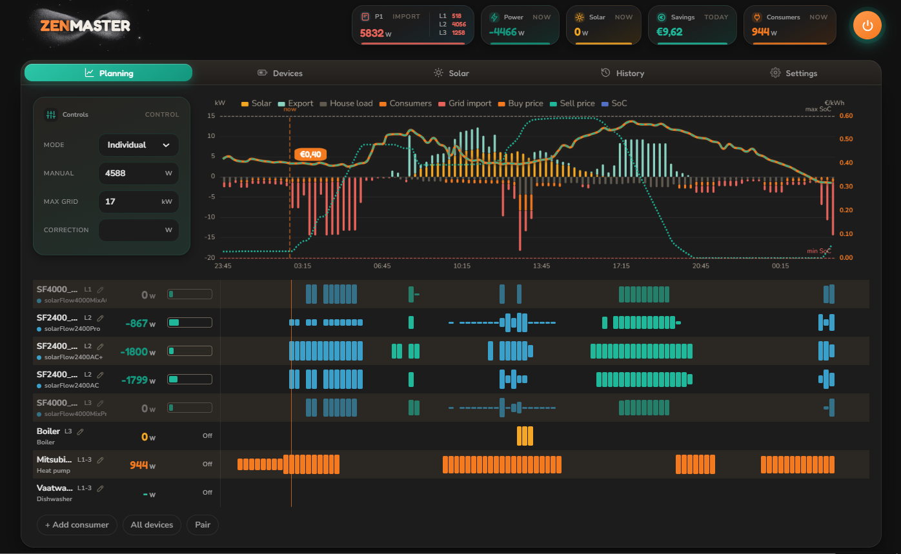

# ZenMaster

ZenMaster is a Home Assistant integration that plans and steers a home battery fleet, heat pumps and other large loads against the dynamic energy price, the solar forecast and the house's own load. Every quarter of an hour it solves a linear optimisation (LP, with the HiGHS solver) over the next 48 hours and sends each device its setpoint.

## The panel

ZenMaster adds its own panel to the Home Assistant sidebar, with five tabs: **Planning**, **Devices**, **Solar**, **History** and **Settings**.

### Header

| Tile | Shows |
|---|---|
| **P1** | Grid import or export now, per phase (L1, L2, L3) |
| **Power** | What the batteries deliver (+) or take (-) now |
| **Solar** | Solar production now |
| **Savings** | What the plan saved today |
| **Consumers** | What the managed consumers draw now |

The round button top right switches the optimisation on or off. On, the battery mode follows the plan every quarter; off, the fleet goes back to its own behaviour.

### Planning chart

The chart shows the plan for the coming 48 hours per quarter:

- **Solar**, **Export**, **House load**, **Consumers** and **Grid import** as bars, in kW.
- **Buy price** and **Sell price** as lines, in EUR/kWh, with the current price marked. Where the day-ahead prices end, the line continues dashed on the price model.
- **SoC** of the fleet as a dotted line, between its min and max.

### Controls

- **Mode**: off, manual, smart, smart charging, smart discharging, store solar, or individual, where every battery gets its own setpoint from the plan.
- **Manual**: the fleet setpoint in manual mode, in W.
- **Max grid**: the connection limit in kW. The plan keeps every phase under its third of it.
- **Correction**: a fixed offset on the setpoint, in W.

### Device and consumer lanes

Under the chart each battery and each consumer has its own lane with its plan per quarter. Hover a bar to see its time and power. Each row shows its phase, its power now and, for a battery, its state of charge. **Add consumer** adds an appliance, a heat pump, a boiler or an EV charger; **All devices** toggles between all and only the online devices; **Pair** connects a new Zendure battery over Bluetooth.

## What ZenMaster plans

### Batteries (Zendure)

- SolarFlow 800, 1600, 2400 and 4000, Hyper 2000, Hub 1200 and 2000, AIO 2400 and Ace 1500, plus the Zendure P1 and CT smart meters.
- Steered over the local zenSDK HTTP API where the device has it, otherwise over a local MQTT broker, with Bluetooth as fallback. Devices are found automatically (MQTT, mDNS, Bluetooth).
- Every battery is planned on its own: its capacity, its power limits, its own solar input, its round-trip loss and its wear. A pack that has worked more than the fleet average costs a little more per kWh, so the plan spreads the work.
- The plan charges when power is cheap or solar is left over and discharges when it is expensive, within the phase limits of the connection.
- The phase of each battery and consumer is detected from its power jumps in the recorder history.

### Heat pump for space heating

- The house is a two-store model (air and building mass) with heat loss, extra loss from wind, solar gain and internal gains. ZenMaster calibrates it every week from a year of recorder history: the daily heat balances on cloudy days give the loss, all cold days give the solar gain and the storage, and the night cooldowns give the share of the air.
- The COP follows from the indoor and outdoor temperature (Carnot with a fixed efficiency), less the energy the defrosts cost. Above a knee of 0.6 kW each extra kW gives less heat, so the plan prefers long, low runs.
- Comfort is a setpoint that must be reached in the evening, with a lower floor by day and at night. The plan only dips under the setpoint when that saves more than the comfort cost, so a night setback only happens when it pays.
- The plan keeps only runs the heat pump can make: no blocks under its minimum power (higher in the cold) and no runs shorter than half an hour.
- The setpoint goes to the heat pump as power, capacity, temperature or temperature difference, whichever its control entity takes.

### Other consumers

- **Hot water heat pump and electric boiler**: the tank is heated in the cheapest window that still keeps it above its minimum.
- **Pool heat pump**: kept in its temperature band at the lowest cost.
- **Dishwasher, washing machine, dryer and custom appliances**: once armed, the cycle is placed in the cheapest window before its deadline, within the phase limits.
- **EV charger**: off, solar (opportunistic while it pays), plan (reach a target SoC before departure) or fast.

### Prices, solar and base load

- **Dynamic prices** from Zonneplan, Tibber, Frank Energie, EnergyCharts or NextEnergy, or the wholesale price with the tariffs of a supplier in the Netherlands, Belgium, Germany, France or Austria (energy tax, grid fees, VAT and the feed-in rule per country). Net metering (saldering) is supported. Beyond the day-ahead prices a price model fitted on the price history fills in the rest of the 48 hours.
- **Solar forecast** from Open-Meteo, per solar group, calibrated against its own meter.
- **Base load** per phase from the last four weeks of the P1 meter, with the managed consumers taken out.

## Installation

1. Copy `custom_components/zenmaster` into the `custom_components` folder of your Home Assistant configuration.
2. Restart Home Assistant.
3. Add the integration **ZenMaster** under Settings, Devices and services.
4. Open the ZenMaster panel in the sidebar and set the P1 meter, the dynamic price provider and the consumers.

ZenMaster needs the Home Assistant recorder for its calibrations and uses `paho-mqtt`, `bleak-retry-connector`, `highspy` and `numpy`, which Home Assistant installs from the manifest.

## Languages

The panel and the settings are available in Dutch, English, German, French and Polish.
